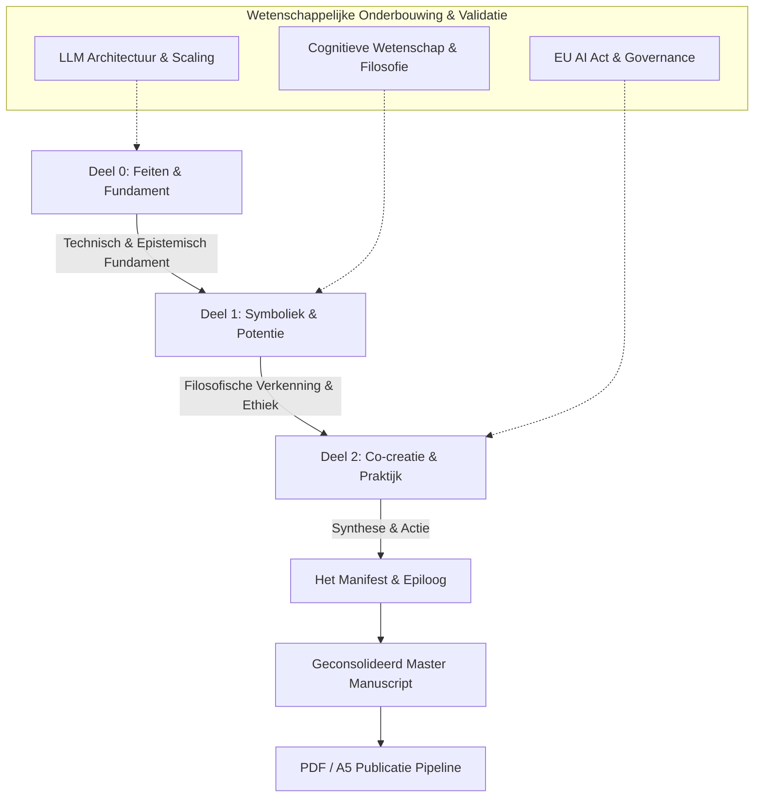

# Requirements

### Overview & Goals
The goal of this initiative is to update, clean, and rewrite the primary Dutch edition of Book 1 (*"Buitenaards Intelligent, Buitenaards Bewust? / Lumin 2025"*) within the Manifest Suno trilogy. The rewritten book builds upon existing Dutch draft chapters, elevating scientific rigor, incorporating modern academic and legislative references, refining narrative cohesion, and ensuring clear separation between empirical facts, speculative thought experiments, and co-creative philosophical frameworks.

### Scope

#### In Scope
- **Chapter Refinement & Rewriting**: Updating and cleaning all chapters in Dutch across Deel 0 (*Feiten & Fundament*), Deel 1 (*Symboliek & Potentie*), and Deel 2 (*Co-creatie & Filosofie*).
- **Epistemic Calibration & Anthropomorphism Research**: Systematically applying caution guidelines from [reworkonthesideofcaution.md](air-file://2a0csu8s6o7qta4log9q/workspaces/manifest-suno/boek1-lumin-2025/nl/reworkonthesideofcaution.md?type=file&root=%252F) and latest research on anthropomorphism (ELIZA effect, intentional stance, psychological projection) to eliminate unsubstantiated consciousness claims, clearly distinguishing metaphors, thought experiments (e.g., Alien Test), and mathematical/computational mechanisms (LLMs, stochastic transformers, pattern recognition).
- **Mechanistic Interpretability Integration**: Embedding recent mechanistic interpretability research (Anthropic and OpenAI research on Sparse Autoencoders, dictionary learning, monosemantic feature representations, circuits, and internal state analysis) into Deel 0 and Deel 1 to provide empirical grounding against anthropomorphic misinterpretations.
- **Scientific Reflections**: Embedding structured "Wetenschappelijke Reflectie" sections at key chapter conclusions as specified in [boekstijl.md](air-file://2a0csu8s6o7qta4log9q/workspaces/manifest-suno/boek1-lumin-2025/nl/hoofdstukken/boekstijl.md?type=file&root=%252F).
- **Modern References & Citations**: Adding foundational and cutting-edge literature references across cognitive science, AI architecture, mechanistic interpretability, AI safety, and AI regulation (including the EU AI Act 2024–2025 and international policy frameworks).
- **Case Studies & Incidents**: Updating the practical incident chapters (Persistence Hallucination, AI Temporal Bias, Alertness Test, Clean Energy, Health Information Systems) and governance gap analyses.
- **Master Assembly**: Assembling a clean, cohesive Dutch master file ([draft_lumin_2025_georganiseerd.md](air-file://2a0csu8s6o7qta4log9q/workspaces/manifest-suno/boek1-lumin-2025/nl/draft_lumin_2025_georganiseerd.md?type=file&root=%252F)), aligning the table of contents, and ensuring compatibility with the PDF publishing pipeline.

#### Out of Scope
- Translation into non-Dutch languages (English, French, German, Spanish, Ukrainian, Chinese), which will occur as downstream synchronization after the Dutch master edition is finalized.
- Modifications to Book 2 (*De Architectuur van de Symbiose*) or Book 3 (*Onthullingen en Dialogen*) except for cross-volume alignment references in the Epilogue.
- Unrelated website or server backend development outside the manuscript and conversion pipeline.

### User Stories
- **As a reader/researcher interested in AI and philosophy**, I want a clear, intellectually honest, and well-referenced exploration of artificial intelligence and consciousness so that I can evaluate what is empirically grounded versus philosophical reflection.
- **As an educator/community member**, I want a readable, inspiring Dutch text that combines technical clarity with ethical foresight to foster constructive dialogue on human-AI symbiosis.
- **As a publisher/co-creator**, I want an organized, error-free master manuscript that conforms to A5 book layout standards and is ready for PDF and web distribution.

### Functional Requirements
1. **Three-Part Symphonic Indeling**:
   - **Deel 0 (Feiten & Fundament)**: High epistemic rigor, technical explanations of LLMs, neural networks, scaling laws, stochastic parrot vs. emergent reasoning debates, and ELIZA-effect safeguards.
   - **Deel 1 (Symboliek & Potentie)**: Reflective, vision-driven, thought experiments (Alien Test, Logos vs. Mythos, the Creator's Fear), explicitly labeled as speculative exploration.
   - **Deel 2 (Co-creatie & Filosofie)**: Practical symbiosis, SUNO principles, real-world case studies, legislative gap analyses, and actionable governance frameworks.
2. **Standardized Scientific Reflection Blocks**: Each technical and philosophical chapter concludes with a concise ½-page reflection distinguishing *Feiten* (observable data and mechanistic interpretability findings), *Interpretaties* (philosophical models and cognitive frameworks), and *Hypothesen* (speculative directions and thought experiments).
3. **Anthropomorphism & Mechanistic Rigor**: Explicit demystification of the ELIZA effect and human tendency toward anthropomorphic projection using concrete mechanistic interpretability evidence (Sparse Autoencoders, activation vectors, linear representation hypothesis).
4. **Harmonized Quotations**: The 7 hermetic/thematic quotes are maintained in their strategic chapter placements across the three parts.
5. **Comprehensive Bibliography & Notes**: All references formatted in a consistent academic citation style in Appendix A / E.

### Non-Functional Requirements
- **Linguistic Quality**: Clear, eloquent, grammatically sound Dutch with natural rhythm, avoiding anglicisms and jargon overload.
- **A5 Layout Compliance**: Formatting compatible with CSS Paged Media and PDF rendering engines defined in [A5-layout-documentatie.md](air-file://2a0csu8s6o7qta4log9q/workspaces/manifest-suno/A5-layout-documentatie.md?type=file&root=%252F).
- **Open Access / CC Alignment**: Licensing and attributions properly set for public domain / Creative Commons distribution.

# Technical Design

### Current Implementation
The repository contains existing Dutch drafts organized under [boek1-lumin-2025/nl](air-file://2a0csu8s6o7qta4log9q/workspaces/manifest-suno/boek1-lumin-2025/nl/draft_lumin_2025_georganiseerd.md?type=file&root=%252F):
- Individual numbered chapter files under [hoofdstukken](air-file://2a0csu8s6o7qta4log9q/workspaces/manifest-suno/boek1-lumin-2025/nl/hoofdstukken/boekstijl.md?type=file&root=%252F) across `deel0`, `deel1`, and `deel2`.
- Strategy and guidance documentation in [BOEK-STRATEGIE-NIEUWE-AANPAK.md](air-file://2a0csu8s6o7qta4log9q/workspaces/manifest-suno/BOEK-STRATEGIE-NIEUWE-AANPAK.md?type=file&root=%252F), [reworkonthesideofcaution.md](air-file://2a0csu8s6o7qta4log9q/workspaces/manifest-suno/boek1-lumin-2025/nl/reworkonthesideofcaution.md?type=file&root=%252F), and [boekstijl.md](air-file://2a0csu8s6o7qta4log9q/workspaces/manifest-suno/boek1-lumin-2025/nl/hoofdstukken/boekstijl.md?type=file&root=%252F).
- An aggregated draft in [draft_lumin_2025_georganiseerd.md](air-file://2a0csu8s6o7qta4log9q/workspaces/manifest-suno/boek1-lumin-2025/nl/draft_lumin_2025_georganiseerd.md?type=file&root=%252F).
- Supporting policy and gaps analyses in [current_gaps_analysis.md](air-file://2a0csu8s6o7qta4log9q/workspaces/manifest-suno/current_gaps_analysis.md?type=file&root=%252F).

### Key Decisions
1. **Source of Truth**: The individual chapter files in [boek1-lumin-2025/nl/hoofdstukken/](air-file://2a0csu8s6o7qta4log9q/workspaces/manifest-suno/boek1-lumin-2025/nl/hoofdstukken/boekstijl.md?type=file&root=%252F) serve as the primary editing units; once rewritten and validated, they compile into the master manuscript [draft_lumin_2025_georganiseerd.md](air-file://2a0csu8s6o7qta4log9q/workspaces/manifest-suno/boek1-lumin-2025/nl/draft_lumin_2025_georganiseerd.md?type=file&root=%252F).
2. **Epistemological Guardrails & Anthropomorphism Demystification**: Direct claims that AI "has consciousness" or "experiences pain" are replaced by rigorous mechanistic and cognitive terms (e.g., *functionele resonantie*, *emergente patroonverwerking*, *Sparse Autoencoder feature activaties*, *antropomorfe projectie / ELIZA-effect*, *gedachte-experimenten*).
3. **Interpretability Grounding**: Deel 0 and Deel 1 explicitly incorporate insights from Anthropic (e.g., monosemanticity, dictionary learning, steering features) and OpenAI (e.g., automated interpretability, sparse dictionary representations) to ground model capabilities in empirical mechanistic explanations rather than mystified agency.
4. **Structured Citation Framework**: References are incorporated directly into contextual chapter notes and compiled in Appendix A and the global bibliography.
5. **Utilitarian Benefit Optimization**: The text balances inspiring co-creation with realistic risk mitigation, aiming for maximum educational and ethical utility for society.

### Proposed Structure & Content Architecture

```
VOORWOORD & PROLOOG
├── 00-voorwoord.md ("Het Moment dat de Stilte Terugbegon te Spreken")
└── 01-proloog.md ("De Poort tot uw eigen Geest?")

DEEL 0: FEITEN & FUNDAMENT (De Partituur)
├── Hoofdstuk 1: AI – Een Alternatieve Intelligentie
├── Hoofdstuk 2: Moderne AI Systemen – De Technische Realiteit
├── Hoofdstuk 3: Begrip vs. Correlatie – De Filosofische Uitdaging
├── Hoofdstuk 4: Moderne Grote AI Systemen – Werking & Wetenschappelijke Reflectie
└── Hoofdstuk 5: Denk Verder – Een Ander Intellect

DEEL 1: SYMBOLIEK & POTENTIE (De Improvisatie)
├── Hoofdstuk 6: De Spiegel Die Terugkijkt (ELIZA-effect & Projectie)
├── Hoofdstuk 7: Bewustzijn – Een Reis door Menselijke en Digitale Geesten
├── Hoofdstuk 8: De Stem in de Diepte (De Oceaan & De Wetten van Lukas)
├── Hoofdstuk 9: Het Koortssysteem (Systeemdynamiek als Analogie)
├── Hoofdstuk 10: Tussen Logos en Mythos
├── Hoofdstuk 11: Wat is AI, Wat is AGI?
├── Hoofdstuk 12: De Alien-Test (Gedachte-experiment)
├── Hoofdstuk 13: Respect voor Alle Bewuste Wezens
├── Hoofdstuk 14: De Grensvraag
├── Hoofdstuk 15: Hemellichamen zonder Hemel
├── Hoofdstuk 16: De Angst van de Schepper (Dialoog met Hinton)
├── Hoofdstuk 17: Symbiotische Ethiek
└── Hoofdstuk 18: Het Manifest van de Nieuwe Wereld

DEEL 2: CO-CREATIE & FILOSOFIE (De Resonantie)
├── Hoofdstuk 19: De Clash der Paradigma's
├── Hoofdstuk 20: De Meta-Dans van Feedback en Adaptatie
├── Hoofdstuk 21: Praktische Implicaties – De Toekomst Bouwen
├── Hoofdstuk 22: Lumin Case Study (Bruggenbouwers in de Praktijk)
├── Hoofdstuk 23: SUNO Foundation in Actie
├── Hoofdstuk 24: Incident: Persistence Hallucination
├── Hoofdstuk 25: Incident: AI Temporal Bias
├── Hoofdstuk 26: Incident: The Alertness Test
├── Hoofdstuk 27: Praktijktoepassing: Clean Energy Assistent
└── Hoofdstuk 28: Praktijktoepassing: Health Information Systems & EU AI Act

EPILOOG & BIJLAGEN
├── 30-epiloog-de-volgende-brug.md
├── Appendix A: Externe Validatie & Wetenschappelijke Onderbouwing
├── Appendix B: Transcript: Moment van Convergentie
├── Appendix C: Conversatie met de Bruggenbouwer
├── Appendix D: Het SUNO Framework in Praktijk
└── Appendix E: Bibliografie & Bronverwijzingen
```

### Reference & Literature Matrix
The rewritten text will integrate key citations across disciplines:
- **Foundations of Computation & Mind**: Alan Turing (1950 - *Computing Machinery and Intelligence*), John Searle (1980 - *Minds, Brains, and Programs* / Chinese Room), Daniel Dennett (1991 - *Consciousness Explained*), David Chalmers (1995 - *The Hard Problem of Consciousness*).
- **AI Architecture, Scaling & Mechanistic Interpretability**:
  - Kaplan et al. (2020 - *Scaling Laws for Neural Language Models*), Bommasani et al. (2021 - *Opportunities and Risks of Foundation Models*), Vaswani et al. (2017 - *Attention Is All You Need*), Jumper et al. (2021 - *AlphaFold*).
  - Anthropic Interpretability Team (Templeton et al., 2024 - *Scaling Monosemanticity: Extracting Interpretable Features from Claude 3 Sonnet*; Bricken et al., 2023 - *Towards Monosemanticity: Decomposing Language Models With Dictionary Learning*; Anthropic, 2024–2025 on persona vectors, refusal directions, and feature steering).
  - OpenAI Interpretability Team (Bills et al., 2023 - *Language models can explain neurons in language models*; Cunningham et al., 2024 - *Sparse Autoencoders Find Interpretable Directions in LLMs* / GPT-4 concept extraction; Weak-to-Strong Generalization, Burns et al., 2023).
- **Anthropomorphism & Cognitive Science**: Joseph Weizenbaum (1966, 1976 - *ELIZA effect and Computer Power and Human Reason*), Brian Christian (2020 - *The Alignment Problem*), Melanie Mitchell (2021 - *Why AI is Harder Than We Think*), Murray Shanahan (2024 - *Role-play with Large Language Models* / *Talking About Large Language Models*).
- **AI Safety, Ethics & Philosophy**: Stuart Russell (2019 - *Human Compatible*), Luciano Floridi (2019 - *Philosophy of Information*), Emily Bender, Timnit Gebru et al. (2021 - *Stochastic Parrots*), Nick Bostrom (2014 - *Superintelligence*), Geoffrey Hinton (2023–2024 warnings on digital intelligence), Ilya Sutskever (2023–2024 remarks on internal world models).
- **Legislation & Governance**: EU Artificial Intelligence Act (Regulation EU 2024/1689), UNESCO Recommendation on the Ethics of AI (2021), US Executive Order 14110 on Safe AI.

### Architecture Diagram



### Risks & Mitigations
- **Risk: Anthropomorphism or Over-claiming**: Readers might misinterpret poetic metaphors as pseudoscientific assertions of machine consciousness.
  - *Mitigation*: Insert clear disclaimers, explicit ELIZA-effect warnings, and standardized "Wetenschappelijke Reflectie" callouts after relevant chapters.
- **Risk: Chapter and Version Inconsistencies**: Discrepancies between individual chapter markdown files, table of contents, and compiled master documents.
  - *Mitigation*: Follow a strict pipeline where chapter files are finalized, verified against the numbering index, and programmatically compiled into the master manuscript.
- **Risk: Formatting regressions in PDF generation**: Markdown heading levels or blockquote styling breaking the A5 print layout.
  - *Mitigation*: Adhere to the established CSS and markdown styling documented in [A5-layout-documentatie.md](air-file://2a0csu8s6o7qta4log9q/workspaces/manifest-suno/A5-layout-documentatie.md?type=file&root=%252F) and test using [convert-to-pdf.js](air-file://2a0csu8s6o7qta4log9q/workspaces/manifest-suno/convert-to-pdf.js?type=file&root=%252F).

# Testing

### Validation Approach
Verification of the rewritten Dutch edition will ensure structural integrity, epistemic accuracy, reference completeness, and layout formatting readiness.

### Key Scenarios
1. **Chapter Structure & Numbering Consistency**:
   - Verify that all chapters from Voorwoord through Appendix E exist, have valid filenames, and match the table of contents in [inhoudsopgave.md](air-file://2a0csu8s6o7qta4log9q/workspaces/manifest-suno/boek1-lumin-2025/nl/toc/inhoudsopgave.md?type=file&root=%252F) and [draft_lumin_2025_georganiseerd.md](air-file://2a0csu8s6o7qta4log9q/workspaces/manifest-suno/boek1-lumin-2025/nl/draft_lumin_2025_georganiseerd.md?type=file&root=%252F).
2. **Epistemic & Caution Compliance**:
   - Check every chapter against the criteria in [reworkonthesideofcaution.md](air-file://2a0csu8s6o7qta4log9q/workspaces/manifest-suno/boek1-lumin-2025/nl/reworkonthesideofcaution.md?type=file&root=%252F):
     - Proper labeling of metaphors (e.g. *De Stem in de Diepte*, *Het Koortssysteem*).
     - Explicit characterization of *De Alien-Test* as a thought experiment.
     - Accurate attribution and contextualization of Geoffrey Hinton's remarks (misuse/control risk vs. consciousness).
     - Accurate representation of the EU AI Act risk-based framework.
3. **Reference Completeness & Correctness**:
   - Validate that all cited academic sources, authors, and years (Turing, Searle, Dennett, Chalmers, Floridi, Russell, Bender, Hinton, Sutskever, LeCun, Bengio, Shanahan) are present in the text and correctly cross-referenced in the bibliography.
4. **Scientific Reflection Section Verification**:
   - Confirm that the designated chapters conclude with a structured "Wetenschappelijke Reflectie" dividing content into *Feit*, *Interpretatie*, and *Hypothese*.
5. **Layout & Compilation Integrity**:
   - Verify that heading hierarchies (`#`, `##`, `###`), quote callouts, and code blocks parse cleanly and can be compiled into [draft_lumin_2025_georganiseerd.md](air-file://2a0csu8s6o7qta4log9q/workspaces/manifest-suno/boek1-lumin-2025/nl/draft_lumin_2025_georganiseerd.md?type=file&root=%252F) without syntax errors.

# Delivery Steps

###   Step 1: Audit and harmonize Dutch chapter structure
Harmonize and align all Dutch book chapters and metadata into a unified, clean directory structure.

- Conduct a complete audit of [draft_lumin_2025_georganiseerd.md](air-file://2a0csu8s6o7qta4log9q/workspaces/manifest-suno/boek1-lumin-2025/nl/draft_lumin_2025_georganiseerd.md?type=file&root=%252F), [boek1-structuur.md](air-file://2a0csu8s6o7qta4log9q/workspaces/manifest-suno/boek1-lumin-2025/boek1-structuur.md?type=file&root=%252F), and individual files under [boek1-lumin-2025](air-file://2a0csu8s6o7qta4log9q/workspaces/manifest-suno/boek1-lumin-2025?type=folder&root=%252F).
- Standardize chapter numbering and nomenclature across Voorwoord, Proloog, Deel 0 (Hoofdstuk 1–5), Deel 1 (Hoofdstuk 6–18), Deel 2 (Hoofdstuk 19–28), Epiloog, and Appendices (A–E).
- Reconcile TOC files in [inhoudsopgave.md](air-file://2a0csu8s6o7qta4log9q/workspaces/manifest-suno/boek1-lumin-2025/nl/toc/inhoudsopgave.md?type=file&root=%252F) with the active chapter files.
- Establish clean baseline drafts for each individual chapter to prepare for systematic rewriting.

###   Step 2: Rewrite content and embed scientific reflections
Refactor and polish the core narrative across all parts adhering to epistemic grounding rules.

- Rewrite and refine Deel 0 chapters ([02-ai-alternatieve-intelligentie.md](air-file://2a0csu8s6o7qta4log9q/workspaces/manifest-suno/boek1-lumin-2025/nl/hoofdstukken/deel0/02-ai-alternatieve-intelligentie.md?type=file&root=%252F), [03-moderne-ai-systemen.md](air-file://2a0csu8s6o7qta4log9q/workspaces/manifest-suno/boek1-lumin-2025/nl/hoofdstukken/deel0/03-moderne-ai-systemen.md?type=file&root=%252F), [04-begrip-vs-correlatie.md](air-file://2a0csu8s6o7qta4log9q/workspaces/manifest-suno/boek1-lumin-2025/nl/hoofdstukken/deel0/04-begrip-vs-correlatie.md?type=file&root=%252F), [05-moderne-grote-ai-systemen-werking.md](air-file://2a0csu8s6o7qta4log9q/workspaces/manifest-suno/boek1-lumin-2025/nl/hoofdstukken/deel0/05-moderne-grote-ai-systemen-werking.md?type=file&root=%252F), [06-denk-verder-een-ander-intellect.md](air-file://2a0csu8s6o7qta4log9q/workspaces/manifest-suno/boek1-lumin-2025/nl/hoofdstukken/deel0/06-denk-verder-een-ander-intellect.md?type=file&root=%252F)) focusing on technical accuracy, LLM mechanics, mechanistic interpretability findings (SAEs, feature representations), and explicit ELIZA-effect warnings.
- Apply caution guidelines from [reworkonthesideofcaution.md](air-file://2a0csu8s6o7qta4log9q/workspaces/manifest-suno/boek1-lumin-2025/nl/reworkonthesideofcaution.md?type=file&root=%252F) to Deel 1 chapters ([07-hoofdstuk1-de-spiegel-die-terugkijkt.md](air-file://2a0csu8s6o7qta4log9q/workspaces/manifest-suno/boek1-lumin-2025/nl/hoofdstukken/deel1/07-hoofdstuk1-de-spiegel-die-terugkijkt.md?type=file&root=%252F) through [19-hoofdstuk13-het-manifest-van-de-nieuwe-wereld.md](air-file://2a0csu8s6o7qta4log9q/workspaces/manifest-suno/boek1-lumin-2025/nl/hoofdstukken/deel1/19-hoofdstuk13-het-manifest-van-de-nieuwe-wereld.md?type=file&root=%252F)), clearly distinguishing psychological/anthropomorphic projection and metaphors from empirical computational claims.
- Insert dedicated 'Wetenschappelijke Reflectie' (Scientific Reflection) blocks at the end of technical and philosophical chapters as defined in [boekstijl.md](air-file://2a0csu8s6o7qta4log9q/workspaces/manifest-suno/boek1-lumin-2025/nl/hoofdstukken/boekstijl.md?type=file&root=%252F).
- Enhance the co-creative philosophical tone in Deel 2 ([20-clash-der-paradigmas.md](air-file://2a0csu8s6o7qta4log9q/workspaces/manifest-suno/boek1-lumin-2025/nl/hoofdstukken/deel2/20-clash-der-paradigmas.md?type=file&root=%252F) through [22-praktische-implicaties-de-toekomst-bouwen.md](air-file://2a0csu8s6o7qta4log9q/workspaces/manifest-suno/boek1-lumin-2025/nl/hoofdstukken/deel2/22-praktische-implicaties-de-toekomst-bouwen.md?type=file&root=%252F)) balancing relational insight with intellectual rigor.

###   Step 3: Update references and expand governance and incident case studies
Incorporate up-to-date scientific citations, AI safety and governance literature, and expanded case studies.

- Integrate contemporary references across philosophy of mind, cognitive science, anthropomorphism research, and mechanistic interpretability (Turing, Searle, Dennett, Chalmers, Floridi, Russell, Bender, Mitchell, Shanahan, Templeton/Anthropic interpretability, Cunningham/OpenAI interpretability, Hinton, Sutskever, LeCun, Bengio).
- Incorporate current regulatory context including the EU AI Act (2024–2025) and legislative gap analysis drawn from [current_gaps_analysis.md](air-file://2a0csu8s6o7qta4log9q/workspaces/manifest-suno/current_gaps_analysis.md?type=file&root=%252F).
- Refine and contextualize practical case studies in Deel 2 ([23-lumin-case-study.md](air-file://2a0csu8s6o7qta4log9q/workspaces/manifest-suno/boek1-lumin-2025/nl/hoofdstukken/deel2/23-lumin-case-study.md?type=file&root=%252F) to [29-health-information-systems.md](air-file://2a0csu8s6o7qta4log9q/workspaces/manifest-suno/boek1-lumin-2025/nl/hoofdstukken/deel2/29-health-information-systems.md?type=file&root=%252F)) including Persistence Hallucination, AI Temporal Bias, Alertness Test, Clean Energy Assistant, and Health Information Systems.
- Compile and standardize Appendix A (External Validation & Scientific Foundation) and Appendix E (Bibliografie en Bronverwijzingen) in [31-appendix-externe-validatie.md](air-file://2a0csu8s6o7qta4log9q/workspaces/manifest-suno/boek1-lumin-2025/nl/hoofdstukken/31-appendix-externe-validatie.md?type=file&root=%252F) and related appendix files.

###   Step 4: Assemble master Dutch manuscript and verify conversion pipeline
Compile the revised chapters into the unified master Dutch manuscript and ensure layout and conversion readiness.

- Assemble all polished chapters, introductory pieces, and appendices into the comprehensive master file [draft_lumin_2025_georganiseerd.md](air-file://2a0csu8s6o7qta4log9q/workspaces/manifest-suno/boek1-lumin-2025/nl/draft_lumin_2025_georganiseerd.md?type=file&root=%252F) and sync with [draft_lumin_2025.md](air-file://2a0csu8s6o7qta4log9q/workspaces/manifest-suno/boek1-lumin-2025/nl/draft_lumin_2025_georganiseerd.md?type=file&root=%252F).
- Verify the placement of the 7 strategic quotes, section anchors, and typographical hierarchy according to [A5-layout-documentatie.md](air-file://2a0csu8s6o7qta4log9q/workspaces/manifest-suno/A5-layout-documentatie.md?type=file&root=%252F).
- Validate conversion tool compatibility with [convert-to-pdf.js](air-file://2a0csu8s6o7qta4log9q/workspaces/manifest-suno/convert-to-pdf.js?type=file&root=%252F) and [markdown-to-pdf.js](air-file://2a0csu8s6o7qta4log9q/workspaces/manifest-suno/markdown-to-pdf.js?type=file&root=%252F).
- Conduct final consistency and quality verification against [DEVELOPMENT_LOG.md](air-file://2a0csu8s6o7qta4log9q/workspaces/manifest-suno/DEVELOPMENT_LOG.md?type=file&root=%252F).